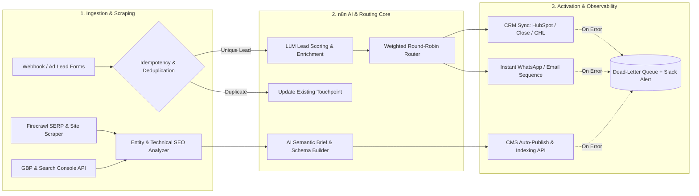

<div align="center">

# `n8n-ai-seo-workflows`
### Enterprise Reference Architectures for Autonomous SEO, Multi-Touch Attribution & Revenue Operations

[](https://n8n.io)
[]()
[]()
[](LICENSE)

**Architected & Maintained by [Mohammad Haider Ali](https://www.linkedin.com/in/mohammad-haider-ali-181737334)**  
*n8n Workflow Automation & Technical SEO Specialist · [LinkedIn](https://www.linkedin.com/in/mohammad-haider-ali-181737334) · [Email](mailto:amhaider442@gmail.com)*

</div>

---

## Overview

`n8n-ai-seo-workflows` is a collection of production-hardened, deterministic **n8n workflow blueprints** engineered for high-growth startups, marketing agencies, and B2B revenue teams. 

Unlike fragile "happy-path" templates, every system in this repository is designed around **four core engineering guarantees**:
1. **Idempotency & Deduplication:** Deterministic SHA-256 / composite key checks (`email` + `phone` + `event_id`) prevent duplicate CRM records, double-messaged leads, and inflated ad attribution.
2. **Structured LLM Outputs:** All AI agent nodes enforce strict JSON Schema validation with fallback parsing and token-budget guardrails.
3. **Resilience & Dead-Letter Routing:** External HTTP nodes implement exponential backoff (`3x` retries) and route terminal failures to a centralized Dead-Letter Queue (DLQ) with instant Slack/Email triage alerts.
4. **Search & Conversion Alignment:** Combines technical/programmatic SEO (Firecrawl SERP extraction, entity graphs, Schema.org JSON-LD, Google Business Profile automation) with full-funnel paid ads attribution (Meta CAPI + GA4 + CRM).

---

## System Architecture



---

## Production Workflows Included

| Module | File Path | Primary Use Case | Core Integrations |
| :--- | :--- | :--- | :--- |
| **01. Autonomous AI SEO & Content Engine** | [`workflows/01-autonomous-ai-seo-content-engine.json`](workflows/01-autonomous-ai-seo-content-engine.json) | Scrapes top-ranking SERP competitors via Firecrawl, extracts semantic entity gaps, generates schema-validated articles + JSON-LD, and publishes to CMS drafts. | `Firecrawl API`, `Anthropic Claude / OpenAI`, `WordPress / Webflow`, `Google Sheets` |
| **02. Multi-Touch Lead Attribution & CRM Pipeline** | [`workflows/02-multi-touch-lead-attribution-crm.json`](workflows/02-multi-touch-lead-attribution-crm.json) | Captures inbound leads & ad UTM metrics, deduplicates against Supabase/BigQuery, scores lead intent with AI, assigns reps via round-robin, and fires Meta CAPI + WhatsApp alerts. | `Webhook`, `Supabase / BigQuery`, `OpenAI / Claude`, `Close / HubSpot CRM`, `WhatsApp API` |
| **03. Local SEO & GBP Review Autopilot** | [`workflows/03-local-seo-gbp-review-autopilot.json`](workflows/03-local-seo-gbp-review-autopilot.json) | Monitors Google Business Profile reviews, classifies sentiment, drafts local-keyword-optimized responses, escalates negative reviews to Slack, and logs local rank metrics. | `Google Business Profile`, `OpenAI`, `Slack`, `Google Sheets` |

---

## Reliability & Production Benchmarks

| Metric / Capability | Standard Template | This Repository (`n8n-ai-seo-workflows`) |
| :--- | :--- | :--- |
| **Webhook Duplicate Protection** | None (creates duplicate CRM rows) | Deterministic `event_id` + `email/phone` upsert check |
| **API Rate-Limit Handling** | Fails on `HTTP 429` | Split-In-Batches + `Retry On Fail (3x, 2000ms backoff)` |
| **Observability & Error Triage** | Silent execution failure | Dedicated `Error Trigger` -> Structured Slack/Email payload |
| **SEO Output Quality** | Generic unformatted AI text | Competitor SERP entity extraction + validated HTML & JSON-LD |

---

## Quickstart & Deployment

1. **Clone this repository:**
   ```bash
   git clone https://github.com/play-tech/n8n-ai-seo-workflows.git
   cd n8n-ai-seo-workflows
   ```
2. **Import into n8n:**
   - Open your n8n instance (`Self-Hosted Docker` or `n8n Cloud`).
   - Navigate to **Workflows → Import from File** and select any JSON blueprint under [`/workflows`](workflows/).
3. **Configure Credentials:**
   - Attach your API credentials (`OpenAI` / `Anthropic`, `Firecrawl`, `Supabase` / `Google Sheets`, `CRM`).
   - Review the architectural guardrails in [`docs/ARCHITECTURE.md`](docs/ARCHITECTURE.md).

---

## Work With Me

Looking to deploy custom **n8n automations**, **multi-touch marketing attribution**, or **technical/programmatic SEO systems** for your business or agency?

- **Author:** Mohammad Haider Ali
- **LinkedIn:** [linkedin.com/in/mohammad-haider-ali-181737334](https://www.linkedin.com/in/mohammad-haider-ali-181737334)
- **Direct Email:** [amhaider442@gmail.com](mailto:amhaider442@gmail.com)
